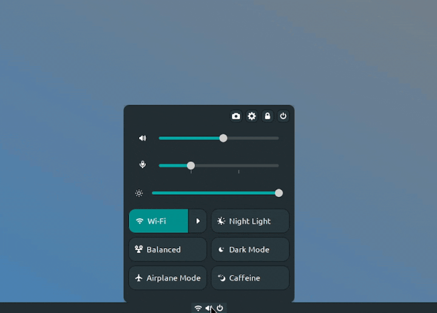

[Türkçe](turkish-README.md)
# Extras Menu

XFCE4 panel plugin. Similar to GNOME's "quick settings" menu, the panel has It offers a pop-up window that opens with a single button: volume and screen brightness sliders, as well as quick switch buttons such as Bluetooth / Wifi/ethernet / Airplane Mode / Night light / Balanced, etc. It maintains the simplicity of XFCE4 and offers a similar structure to the Gnome quick settings menu.

## Installation (Recommended)
```bash
bash install.sh
```
## Pictures

## Dependencies

### Arch Linux

```bash
sudo pacman -S brightnessctl power-profiles-daemon --needed
````

### Debian / Ubuntu

```bash
sudo apt install power-profiles-daemon brightnessctl
```

### Fedora

```bash
sudo dnf install power-profiles-daemon brightnessctl
```
## Final Touches
### Systemd
```bash
sudo systemctl enable --now power-profiles-daemon
```
## Build and Installation

```bash
make
make install
```

After installation, restart the panel (Recommended):

```bash
xfce4-panel -r
```

It can be added to the panel by right-clicking → Panel → Add New Items...
and selecting "Extras Menu".

### Notes
There is no note at the moment...