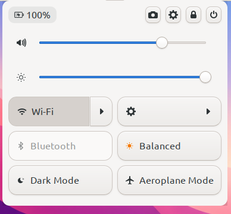
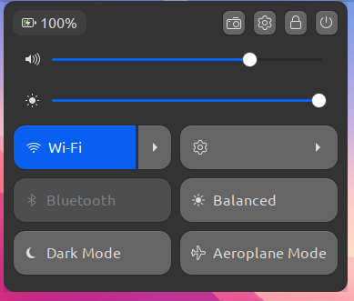
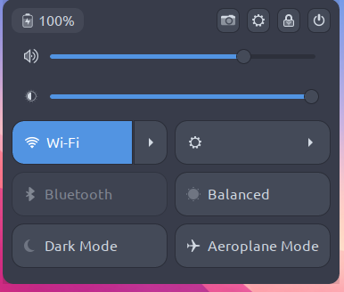

[English](README.md)
# Extras Menu

XFCE4 panel eklentisi. GNOME'un "hızlı ayarlar" menüsüne benzer, panelde
tek bir düğmeyle açılan bir açılır pencere sunar: ses ve ekran parlaklığı
kaydırıcıları, ayrıca Bluetooth / Wifi/ethernet / Airplane Mode / Night light/ Balanced vb. gibi hızlı geçiş düğmeleri. Hem XFCE4'ün sadeliğini korur hemde Gnome hızlı ayarlar menüsüne benzer yapı sunar.

## Kurulum (Önerilen)
```bash
bash install.sh
```
## Görseller



## Bağımlılıklar

### Arch Linux

```bash
sudo pacman -S brightnessctl power-profiles-daemon --needed
```

### Debian / Ubuntu

```bash
sudo apt install power-profiles-daemon brightnessctl
```

### Fedora

```bash
sudo dnf install power-profiles-daemon brightnessctl
```
## Son dokunuş
### Systemd
```bash
sudo systemctl enable --now power-profiles-daemon
## Derleme ve kurulum

```bash
make
make install
```

Kurulumdan sonra paneli yeniden başlatmak (tavsiye edilir):

```bash
xfce4-panel -r
```

Panelde sağ tık → Panel → Öğe Ekle... üzerinden "Extras Menu" olarak eklenebilir.

## Notlar
Şuan her hangi bir not yok...